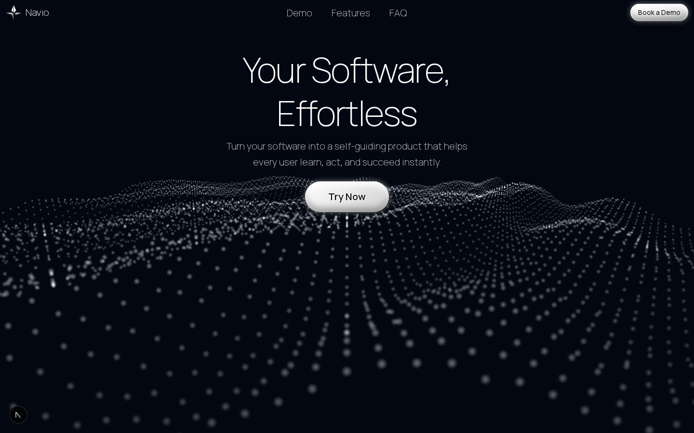

# Navio Website

The Navio marketing website presents an AI assistant for software onboarding, guided workflows, and task automation. It includes the landing page, pricing and security pages, and legal information.



*The homepage rendered locally.*

## Run locally

Requires Node.js 20 or later and npm.

```bash
git clone https://github.com/MolanoJF/navio-website.git
cd navio-website
npm ci
npm run dev
```

Open [http://localhost:3000](http://localhost:3000). Links to the hosted demo and booking service point to external sites.

## Project layout

- `src/app/` — Next.js App Router pages, metadata, and global styles.
- `src/components/` — landing-page sections and UI components.
- `public/` — logos, images, and other static assets.
- `open-next.config.ts` and `wrangler.jsonc` — OpenNext and Cloudflare deployment configuration.

The site uses Next.js 15, React 19, TypeScript, Tailwind CSS, Motion, and Three.js. `npm run build` builds the Next.js application; `npm run preview` builds and previews the Cloudflare version. `npm run deploy` deploys to Cloudflare and requires the appropriate account configuration.

## License

The existing project documentation identifies this project as private and proprietary to SAIL. No open-source license is included.
